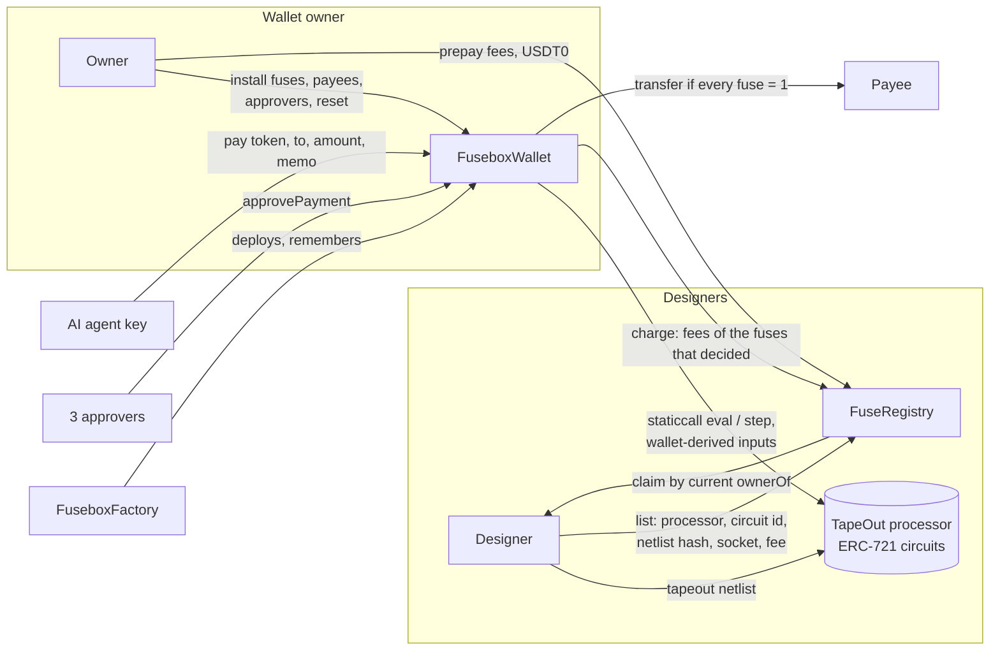
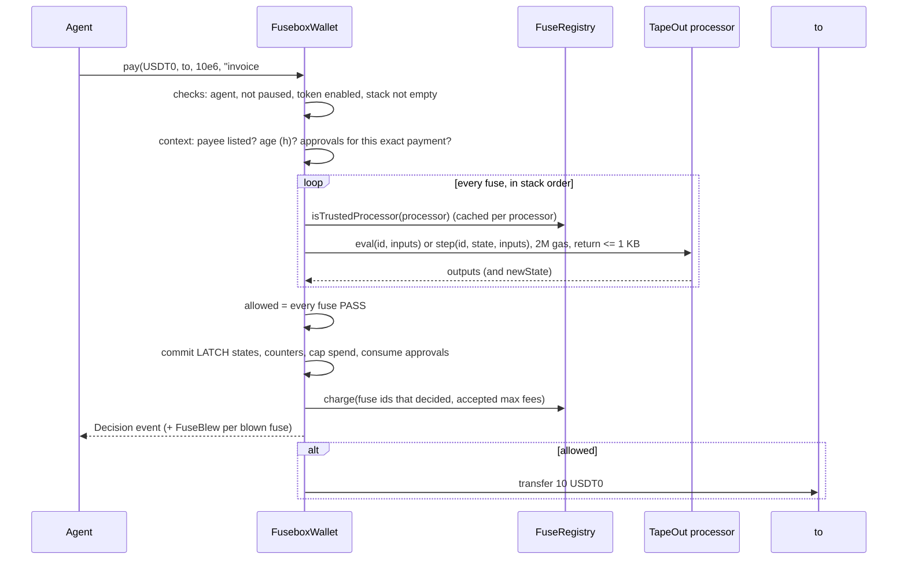
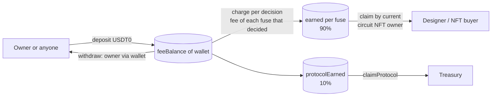

# Fusebox architecture

Fusebox is a marketplace of TapeOut guard circuits ("fuses") for AI agent wallets on X Layer (chain 196).
Designers tape out small NAND/LATCH circuits and list them with a per-decision USDT0 fee. Agent owners stack
the fuses they want on a wallet. Every payment the agent attempts is put to every fuse; it executes only if
every circuit outputs 1, and every fuse that decided is paid, including the ones that said no.

This document covers the contracts (`contracts/`) and the circuit toolchain (`circuits/`). There is no
frontend yet.

## 1. Components



| Contract | Role |
|---|---|
| `FuseRegistry` | Marketplace and fee ledger. Lists circuits as fuses (only the circuit NFT owner can list), pins processor, circuit id and netlist hash, checks pinout and gate budget against the chain, keeps prepaid fee balances and per-fuse earnings, decides which processors are trusted. |
| `FuseboxWallet` | Minimal smart account for one agent setup: owner, agent keys, ordered fuse stack (max 8), payee book, three approver seats, LATCH state, counters. |
| `FuseboxFactory` | Deploys wallets bound to one registry and records them (`isWallet`) so indexers can trust their events. |
| `Sockets` (library) | The pinouts: which input bit means what, parameter validation, quantisation, bit packing. |

### Why a standalone wallet, not a Safe module

The agent's key must have exactly one way to move value, and that way must go through the fuses. A
standalone minimal account makes that a property of about 600 lines that can be read in one sitting: the
agent can call `pay` and `freeze`, nothing else; the owner holds every other power, including `execute`.
A Safe module would also need the Safe's own owners, guards and modules to be reasoned about, and a Safe
would let any other module or owner bypass the fuses. OKX's Agentic Wallet (a TEE-held EOA) plugs in as the
agent key unchanged. The fuse evaluation itself (`_decide`, `_evaluate`) has no wallet-specific state
beyond the slot, so wrapping it as a Safe guard or ERC-7579 hook later is mechanical.

## 2. One decision



Fuse status per decision: `PASS` (all output bits 1), `BLEW` (circuit answered 0), `FAILED` (call reverted,
ran out of its gas allowance, or returned malformed or oversized data), `UNTRUSTED` (the registry no longer
trusts the processor). Anything but `PASS` blocks. `FAILED` and `UNTRUSTED` fuses are not charged.

The `Decision` event carries the decision id, agent, payee, token, amount, verdict, and per fuse: id,
status, the packed input bits and the packed outputs, plus the fee paid, the approval intent hash and the
agent's memo. `check(token, to, amount)` is the same evaluation as a view, for UIs and agents to dry-run.

## 3. Sockets: the input schemas

A *socket* is the contract between the wallet and a circuit: the wallet derives the bits, the circuit
decides. Several designers can tape out different circuits for the same socket. The registry refuses a
listing whose `circuitInfo` (nIn, nOut) does not match the socket. Bits are packed least-significant first
(TAP-02 §5). Amounts are quantised by the install's `unit` with `ceil(amount / unit)`, saturating at 255;
owner parameters are capped at 254, so a saturated amount can never satisfy `amount <= parameter`.
A payment in any token other than the install's token reads `amount = 255` (fails closed).

| Socket | Inputs | Bits | Derived by the wallet from |
|---|---|---|---|
| 1 `DAILY_CAP` | 24 | `[0..7]` amount, `[8..15]` spent today, `[16..23]` cap | payment; per-slot spend in the current UTC day (`block.timestamp / 1 days`), rounded up; owner's cap |
| 2 `PAYEE_GUARD` | 33 | `[0]` listed, `[1..8]` age in hours (sat. 255), `[9..16]` cooldown h, `[17..24]` amount, `[25..32]` trial | owner's payee book (`addPayee` timestamps); owner's cooldown and trial allowance |
| 3 `BREAKER` | 4, sequential | `[0]` set, `[1]` clear, `[2]` attempt, `[3]` suspect | payment beat: attempt = 1, suspect = payee not in book. Control beat: set (owner, agent or approver), clear (owner only) |
| 4 `APPROVAL_2OF3` | 19 | `[0..2]` approver bits, `[3..10]` amount, `[11..18]` threshold | on-chain approvals for this exact payment within the TTL; owner's threshold |

Owner parameters per installed fuse: `Params{token, unit, a, b}`; `a` = cap / cooldown hours / threshold,
`b` = trial allowance. The breaker takes none.

## 4. The circuits

Built with `circuits/` (TypeScript, no runtime dependencies): a gate-level builder (structural hashing,
constant folding, double-negation removal, dead-gate removal, output placement), a TAP-02 encoder,
decoder and evaluator (including REF), and a 32-lane bitsliced simulator for exhaustive tests.

| Fuse | Socket | NAND | LATCH | Gates | Netlist | keccak256 |
|---|---|---|---|---|---|---|
| Daily Cap | 1 | 108 | 0 | 108 | 756 B | `0xd65b2e8a…5fcfdd97` |
| Payee Guard | 2 | 79 | 0 | 79 | 553 B | `0x2d1dc771…15569099` |
| Breaker | 3 | 10 | 1 | 11 | 74 B | `0xb3a4fd12…12c4f4ea` |
| Two of Three | 4 | 46 | 0 | 46 | 322 B | `0x1236c24f…00575027` |

Full hashes and netlists: `circuits/build/fuses.json`.

**The comparator.** Every fuse except the breaker needs `x <= y` on 8-bit values. It is the carry chain of
`y + NOT x + 1` (no borrow means `x <= y`), and it needs no inverters: with `n1 = NAND(x, y)`,
`n2 = NAND(y, n1) = NOT(y AND NOT x)` and `n3 = NAND(x, n1) = y OR NOT x`, the carry is
`c' = NAND(n2, NAND(c, n3))`. That is 5 NANDs per bit and 2 for bit 0: **37 NANDs for 8 bits**,
against 51 for a carry chain with explicit inverters (NOT + 6-NAND majority per bit) and about 80 for a
full-adder subtractor.

**Daily Cap**: `spent + amount <= cap`. A ripple-carry adder (half adder + 7 full adders, 68 NANDs) feeds the
comparator (37); the adder's carry out must be 0 (3 more).

**Payee Guard**: `listed AND (age >= cooldown OR amount <= trial)`: two comparators (74) and 5 gates of glue.
A new payee can receive a small test payment, not the invoice, until the cooling-off period has passed.

**Breaker**: one LATCH `q`, and
`trip = attempt AND suspect`, `q' = set OR trip OR (q AND NOT clear)`, `out = NOT q AND NOT trip`.
A payment to a stranger blocks itself and latches; every later payment is blocked until the owner clears it.
`set` wins over `clear`. 10 NANDs + 1 LATCH.

**Two of Three**: `amount <= threshold OR MAJ(a0, a1, a2)`: comparator (37), majority (6), OR (3).

**Verification** (`npm test` in `circuits/`, 17 tests): the toolchain passes the official TAP-02 vectors
(file pinned by SHA-256, including LATCH and REF cases and every ill-formed case); every fuse is checked
through its encoded bytes: all 2^24 Daily Cap vectors and all 2^19 Two of Three vectors, the Payee Guard
exhaustively per comparator block plus 4M random vectors, the Breaker on every (state, input) pair plus
scripted sequences; and a stuck-at fault test shows that every gate of every combinational fuse is
observable (none is redundant). The same spec vectors are replayed on the Solidity mock processor and on
the real X Layer processor in the fork tests.

## 5. LATCH state: who may advance it

The wallet stores each sequential fuse's state bytes and is the only writer.

- **Payment beats.** Every decision is exactly one beat of every sequential fuse, allowed or blocked
  (a blocked payment must be able to trip the breaker). Inputs are derived by the wallet; the agent only
  chooses (token, to, amount). State is committed only when the fuse returned well-formed outputs
  (`PASS` or `BLEW`).
- **Control beats.** Only sockets with owner pins (BREAKER) accept them: `freeze()` drives `set` (owner,
  agents, approvers: anyone in the circle can blow the fuse), `unfreeze()` and `pulse()` drive `clear`
  (owner only). Control beats are not charged.
- Past `maxBlockedPerDay` recorded blocks, a blocked attempt reverts, so its beat is not committed.

Designers of sequential circuits for other sockets must assume one beat per decision, including blocked
ones, and no beats otherwise.

## 6. Fee flow



- Fees are prepaid into the registry, not held by the wallet, so the agent's spendable balance and the fee
  budget never mix, and a decision moves internal balances only (no token transfer per fuse, so a designer
  that USDT0 has blacklisted cannot block anyone's payments).
- **Blocked attempts pay.** The "no" is the product: the designer's circuit did the work and stopped a
  loss. Two guards keep that from becoming a drain: after `maxBlockedPerDay` (default 20) recorded blocks
  in a UTC day, further blocked attempts revert without being recorded or charged (allowed payments are
  unaffected), and the owner's kill switch (`setPaused`) stops evaluation entirely. `FAILED` or
  `UNTRUSTED` fuses are not charged.
- **Fee changes.** The wallet pins the highest fee the owner accepted per slot (`maxFee`). A decrease
  applies at once; an increase makes `charge` revert until the owner accepts it (`setFuseMaxFee`), so a
  designer cannot raise the price on installed wallets.
- **Not enough balance**: the whole payment reverts (fail closed: no payment without paying the fuses).
- **Selling the income stream.** Earnings accrue per fuse id, and `claim` pays whoever holds the circuit NFT
  at claim time. Unclaimed earnings move with the NFT; a seller should claim first.
- The protocol share is set by the registry admin, at most 20% (deployed with 10%).
- `totalOwed` (fee balances + unclaimed earnings + protocol earnings) never exceeds the registry's USDT0
  balance; a fuzz test checks the books.

## 7. Threat model

| Threat | Mitigation |
|---|---|
| Fake processor: a contract that mimics the ABI and always answers 1 | Registry accepts a processor only if its runtime code hash is allowlisted. Every TapeOut processor is the same beacon proxy (`0x57aa306f…`, the beacon address is in the code), the factory must list it (`isCPU`), and the beacon must point at an attested implementation. Checked at listing and again at every decision. |
| TapeOut upgrades the circuit implementation (factory not sealed) | Every decision re-reads `beacon.implementation()`; an unattested implementation makes every fuse `UNTRUSTED`: payments are blocked and no fee is charged until the registry admin attests the new code. Tested on the fork with a mocked beacon. |
| Malicious or wrong listing (wrong pinout, different netlist, huge circuit) | Listing reads `circuitInfo` and `netlist` from the processor: nIn/nOut must match the socket, at most 512 gates and 64 state bits, keccak256 of the stored netlist must equal the hash the designer signed. Only the NFT owner can list, once per circuit. |
| Copied design listed cheaper | Allowed (netlists are public); `originalOf[netlistHash]` records the first listing so the marketplace can label originals. |
| Prompt-injected agent ("sure thing, boss") | The agent supplies only (token, to, amount, memo); all input bits are derived on chain. Unknown payee: Payee Guard blows and the Breaker latches. |
| Agent key stolen | Same as above, plus caps and approvals; the owner can remove the agent, pause, or `execute` funds out. The agent can freeze but never unfreeze. |
| Agent uses `token` to call arbitrary contracts | `pay` only accepts owner-enabled tokens. |
| Approval replay | An approval is bound to chain id, wallet, approver epoch, token, payee and amount; it expires `approvalTtl` (default 1 day) after the first approval and is deleted when the payment executes. Changing approvers bumps the epoch. |
| Designer raises the fee on installed wallets | Per-slot `maxFee`; higher fees revert until the owner accepts. |
| Fee drain by a looping agent | Daily limit on recorded blocked attempts; kill switch. |
| Reentrancy (malicious token, native payee) | `nonReentrant` on `pay`, control beats, `execute`, registry money functions; state and fees committed before the transfer, which is the last call. Tested with a token that re-enters. |
| Gas starvation: agent sends just enough gas for a fuse to fail | Each fuse call gets a fixed 2M gas; `pay` reverts with `InsufficientGas` unless that is fully available (EIP-150 aware). |
| Return-data bomb or malformed return | `staticcall` with bounded return (1 KB), bounds-checked ABI decoding; any problem is `FAILED`, which blocks. |
| Input schema mismatch | Socket pinout enforced at listing; inputs built only by `Sockets`; output length checked against nOut; LATCH state length checked against nState. |
| Quantisation lets more through | Amount and spent round up; saturation at 255 with parameters capped at 254. Fuzz test: a random day of payments never moves more than the cap. |
| Time | Hours and UTC days only; X Layer's sequencer timestamps are far more precise than that. |
| Registry admin | Can change trust settings and the protocol share (≤ 20%); cannot touch fee balances or earnings. Should be a multisig before launch. |

Trust assumptions that remain: TapeOut's factory owner can upgrade code (mitigated by fail-closed
attestation), USDT0's issuer can freeze addresses, and the wallet owner is fully trusted.

## 8. Gas (X Layer mainnet fork, real OrderGuard processor)

Measured on a fork of X Layer at block ~75.82M (2026-11-13) with `vm.cool`, so every account and slot
starts cold as it would in a real transaction. Excludes the 21k transaction base cost and calldata.

| Fuse | Gates | Cold eval/step call | Warm call |
|---|---|---|---|
| Daily Cap | 108 | 282,564 | 260,587 |
| Payee Guard | 79 | 210,890 | 198,414 |
| Breaker (step) | 11 | 50,082 | 37,607 |
| Two of Three | 46 | 131,703 | 119,229 |

About 2,400 gas per gate, in line with TAP-02's 2,317 on BNB Smart Chain.

| `pay()` (cold) | Gas |
|---|---|
| Daily Cap only, allowed | 395,187 |
| + Payee Guard, allowed | 642,035 |
| + Breaker, allowed | 730,785 |
| All four, allowed | 898,262 |
| All four, blocked (scam) | 882,324 |
| First decision of a new wallet (fresh storage), all four | ~1,215,000 |

At X Layer's ~0.02 gwei that is about 0.000018 OKB per four-fuse decision. Wallet overhead per decision
(inputs, trust check, fee ledger, events, USDT0 transfer) is roughly 110k gas. Callers must provide at
least about 2.05M gas of headroom for the last fuse call (`eth_estimateGas` finds it automatically).

## 9. Running it

```sh
# circuits: typecheck, tests, build netlists + Solidity fixtures
cd circuits && npm install && npm run typecheck && npm test && npm run build

# contracts: unit tests (offline)
cd contracts && forge build && forge test

# fork tests against X Layer mainnet (read-only fork, nothing is broadcast)
forge test --match-path test/fork/XLayerFork.t.sol --fork-url xlayer -vv
```
